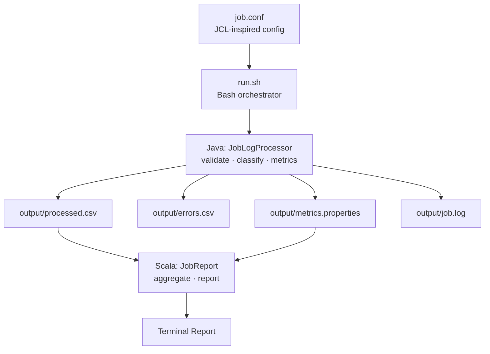

# Mini Mainframe Job Log Processor

Hello everyone, I wanted to understand more about z/OS batch processing on mainframes, so I made a small, backend-focused pipeline inspired by **IBM z/OS batch processing** concepts. I also used IBM Bob to help me build this.

---

## What It Does

This MVP is scoped, but the main functionality is as follows:
Reads a CSV of synthetic mainframe-style job execution records, validates and classifies each step by return code, writes clean output files, and generates a terminal report, and this is all orchestrated by a Bash script and packaged in a single Docker container.

> **Note:** This project DOES NOT run on real z/OS. It does not implement JCL syntax,
> JES job submission, or any actual mainframe component. I just made this MVP to capture z/OS concepts in a smaller, scoped environment.

---

## Architecture



---

## Tech Stack

| Tool | Role |
|------|------|
| **Java** | CSV processing, return code classification, lifecycle tracking, performance measurement |
| **Scala** | Analytics aggregation and terminal report generation |
| **Bash** | Orchestrates compile → Java → Scala, reads `job.conf` |
| **Docker** | Single-container packaging; one command runs the full workflow |

I used no other frameworks, no build tools beyond `javac`/`scalac`, no external services.

---

## Project Structure

```
mainframe-job-analyzer/
├── Dockerfile
├── README.md
├── job.conf              ← JCL-inspired job configuration
├── run.sh                ← Bash orchestrator
├── test.sh               ← Lightweight shell test suite
├── generate_data.py      ← Synthetic data generator (dev only)
├── data/
│   └── job_logs.csv      ← 620 records: 600 valid, 20 intentionally invalid
└── src/
    ├── JobLogProcessor.java
    └── JobReport.scala
```

---

## How to Run

> **Test data is already included** — `data/job_logs.csv` ships with 620 synthetic
> records (600 valid + 20 intentionally malformed). No setup needed beyond cloning.

### Option 1 — Docker (no local Java/Scala required)

```bash
git clone <this-repo> && cd mainframe-job-analyzer

docker build -t mini-mainframe .
docker run --rm mini-mainframe
```

Run the test suite inside the same container:

```bash
docker run --rm --entrypoint bash mini-mainframe -c "bash test.sh"
```

### Option 2 — Run locally

**Prerequisites:** Java 21 and Scala 2.13 on your `PATH`.

```bash
git clone <this-repo> && cd mainframe-job-analyzer

chmod +x run.sh test.sh
./run.sh          # compile + process + report
./test.sh         # 15 lightweight assertions
```

Output files are written to `output/` after each run:

| File | Contents |
|---|---|
| `output/processed.csv` | Valid records with RC classification |
| `output/errors.csv` | Rejected records with rejection reason |
| `output/metrics.properties` | Timing and throughput from Java |
| `output/job.log` | Timestamped lifecycle events |

Re-running always replaces these files — no duplicate appending.

---

## Example Output in terminal

```
Compiling Java source...
Compiling Scala source...

Starting analysis job: LOG_ANALYSIS_001
Input: data/job_logs.csv → Output: output/

[05:11:55] JOB STARTED: LOG_ANALYSIS_001
[05:11:55] Processing data/job_logs.csv
[05:11:55] Valid: 600 | Rejected: 20 | Duration: 21 ms | Throughput: 28468 rec/s
[05:11:55] JOB COMPLETED: LOG_ANALYSIS_001

==================================================
      MAINFRAME JOB ANALYSIS REPORT
==================================================

Analysis Job : LOG_ANALYSIS_001
Status       : COMPLETED

── Input Records ────────────────────────────────
Total Records    : 620
Valid Records    : 600
Rejected Records : 20

── Job Summary ──────────────────────────────────
Unique Jobs      : 200
Successful Jobs  : 124
Failed Jobs      : 63
Unknown Jobs     : 13

── Step Analytics ───────────────────────────────
Avg Step Duration        : 269 ms
Most Common Failure Step : REPORT
Highest Return Code      : 16

── Analyzer Performance ─────────────────────────
Processing Time  : 21 ms
Throughput       : 28,468 records/sec

==================================================
```

---

## Mainframe Concepts I Explored

| z/OS Concept | This Project's Analogy |
|---|---|
| **z/OS batch processing** | Java reads and processes records sequentially, one at a time, no threads, like a mainframe batch step |
| **JCL job definitions** | `job.conf` defines `JOB_NAME`, `INPUT`, and `OUTPUT`, conceptually similar to a JCL `JOB` card |
| **Multi-step batch jobs** | Java processing followed by Scala reporting = two dependent job steps |
| **Step return codes** | RC 0 → SUCCESS, RC 4 → WARNING, RC ≥ 8 → FAILURE, mirroring z/OS RC conventions |
| **Job output / SYSOUT** | `job.log` and CSV files mirror JES SYSOUT and SYSPRINT DD datasets |
| **Workload monitoring** | Processing metrics (throughput, duration) mirror the SMF records used for z/OS capacity planning |

---

## Return Code Classification Policy

Simplified from z/OS conventions (actual policies differ by installation):

| Return Code | Classification |
|---|---|
| `0` | SUCCESS |
| `4` | WARNING |
| `≥ 8` | FAILURE |
| Other non-negative | UNKNOWN |

---

### Please try it! Thanks so much for checking this out.
